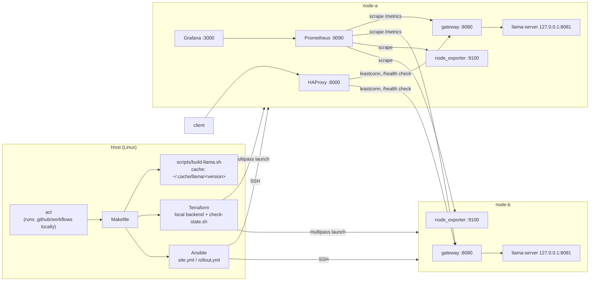
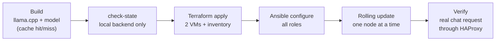

# Local Fleet CI/CD: llama.cpp on a Multipass fleet

A small, fully local "production-like" inference fleet:

- **Terraform** creates 2 Ubuntu 24.04 VMs with **Multipass** (state stays local).
- **Ansible** configures them: llama.cpp server (built from source, CPU), a small Python gateway, HAProxy load balancer, Prometheus and Grafana.
- **GitHub Actions workflows** run locally with **nektos/act**: build, deploy with a rolling update, plan, and lint.
- One small GGUF model: **Qwen2.5-0.5B-Instruct (Q4_K_M)**.

Everything runs on one Linux host. No cloud services, no remote state.

---

## Architecture



| Component | Where | Role |
|---|---|---|
| llama-server | each node, `127.0.0.1:8081` | runs the model; only reachable through the gateway |
| gateway (`gateway.py`) | each node, `:8080` | adds request IDs, JSON logs, `X-Served-By` / `X-Release` headers, request/latency metrics; forwards everything else to llama-server |
| HAProxy | node-a, `:8000` | single entry point; health-checks both gateways; admin socket used to drain a node during rollout |
| Prometheus | node-a, `:9090` | scrapes both gateways and both node_exporters every 15 s |
| Grafana | node-a, `:3000` | provisioned datasource + "Llama Fleet" dashboard |
| node_exporter | each node, `:9100` | CPU/memory/disk + the model load time (textfile collector) |

### Pipeline (deploy workflow)



### Rolling update and rollback (`ansible/rollout.yml`)

`serial: 1`, so one node at a time:

1. Record which release `/opt/llama/current` points to.
2. **Drain** the node in HAProxy (admin socket): no new requests go to it.
3. Install the release into `/opt/llama/releases/<version>/` and point the `current` symlink at it; restart llama-server.
4. Wait for `/health` = 200, then send a **real chat request** and check the answer.
5. **On any failure (rescue):** point `current` back to the recorded release, restart, wait for health, then fail the run with a clear message.
6. **Always:** put the node back into HAProxy (`ready`).

The other node keeps serving the whole time, so the service stays available during updates.

---

## Requirements

### Host

| | Minimum (estimated, not tested) | Used for testing |
|---|---|---|
| OS | Linux with KVM (Ubuntu 22.04/24.04) | Ubuntu 22.04.5 LTS |
| CPU | 6 vCPU (2 VMs × 2 + host) | 30 vCPU |
| RAM | 12 GB (2 VMs × 4 GB + host) | 222 GB |
| Disk | 40 GB free | 1.4 TB |

### Observed runtime

Measured on the test hosts above (2 runs on 2 different cloud VMs). VM-side numbers depend mostly on the 2 vCPU per VM, not on the host size.

| Measurement | Value |
|---|---|
| Full pipeline from zero (`make act-rollout`, build cached) | **3 min 10 s** |
| ├ build (cache hit) | 0.4 s |
| ├ create 2 VMs | 1 min 01 s |
| ├ configure (all roles) | 1 min 51 s |
| ├ rolling update (2 nodes) | 17 s |
| └ verify (chat request) | 0.2 s |
| llama.cpp build from source (cache miss) | one-time per version, several minutes |
| Binary / model size | 18 MB (self-contained: no llama/ggml shared libraries) / 469 MB |
| VM size | 2 vCPU, 4 GB RAM, 15 GB disk each |
| VM usage after deploy | node-a 886 MiB RAM, 5.0 GiB disk (incl. Prometheus + Grafana); node-b 584 MiB RAM, 2.4 GiB disk |
| Model load time | 0.85 s (second run) and 1.29 s (first run) |
| Generation speed | about 41 tokens/s per node (2 vCPU), first run |
| Latency, 5-token replies | p50 0.175 s, p95 0.24 s, first run |

---

## Setup

### Linux (Ubuntu): tested

```bash
# VMs, IaC, config management
sudo snap install multipass
wget -qO- https://apt.releases.hashicorp.com/gpg | sudo gpg --dearmor -o /usr/share/keyrings/hashicorp.gpg
echo "deb [signed-by=/usr/share/keyrings/hashicorp.gpg] https://apt.releases.hashicorp.com $(lsb_release -cs) main" | sudo tee /etc/apt/sources.list.d/hashicorp.list
sudo add-apt-repository -y ppa:ansible/ansible
sudo apt-get update && sudo apt-get install -y terraform ansible jq make git build-essential cmake

# act (local GitHub Actions)
curl -s https://raw.githubusercontent.com/nektos/act/master/install.sh | sudo bash -s -- -b /usr/local/bin
echo "-P ubuntu-latest=catthehacker/ubuntu:act-22.04" > ~/.actrc

# linters
sudo apt-get install -y shellcheck yamllint pipx unzip
pipx install ansible-lint && pipx ensurepath
curl -sLO https://github.com/terraform-linters/tflint/releases/latest/download/tflint_linux_amd64.zip && unzip -o tflint_linux_amd64.zip && sudo mv tflint /usr/local/bin/
bash <(curl -s https://raw.githubusercontent.com/rhysd/actionlint/main/scripts/download-actionlint.bash) && sudo mv actionlint /usr/local/bin/

# Molecule (role tests) with podman
sudo apt-get install -y podman
pipx install molecule && pipx inject molecule ansible-core "molecule-plugins[podman]"
ansible-galaxy collection install containers.podman ansible.posix -p ~/.ansible/collections

# first multipass call (creates and trusts the client certificate)
multipass list
```

### macOS: not tested

Install the same tools with Homebrew (`brew install --cask multipass`, `brew install terraform ansible act jq tflint actionlint shellcheck yamllint ansible-lint`). Multipass on macOS uses its own hypervisor. The Makefile and Ansible parts are unchanged; the hard-coded host paths (see Known limitations) must be adjusted.

### Windows: not tested

Use a Linux machine or an Ubuntu VM for the host. Multipass, Ansible and act cannot all run together natively on Windows: Ansible has no Windows control node, and Multipass inside WSL2 is not supported.

---

## Usage

Clone to `~/fleet` (see Known limitations), then:

```bash
make setup         # SSH key, Grafana admin password (outside git), terraform init
make act-rollout   # full deploy workflow through act: build → apply → configure → rollout → verify
make verify        # one chat request through HAProxy
```

| Command | What it does |
|---|---|
| `make setup` | create `~/.ssh/fleet_key`, create `~/.config/fleet/grafana_admin_password` (random, mode 600), `terraform init` |
| `make build` | download the model and build llama.cpp for `llama_version`; both cached, so a re-run takes under a second |
| `make plan` / `make apply` | Terraform plan / apply (both run `check-state` first) |
| `make configure` | `ansible-playbook site.yml` (all roles) |
| `make rollout` | rolling update with rollback |
| `make verify` | chat request through HAProxy on node-a:8000 |
| `make act-plan` | `.github/workflows/plan.yml` through act (drift check: "No changes") |
| `make act-rollout` | `.github/workflows/deploy.yml` through act |
| `make act-ci` | `.github/workflows/ci.yml` through act (all linters) |
| `make lint` | terraform fmt -check, terraform validate, tflint, shellcheck, yamllint, ansible-lint, actionlint |
| `make test-tf` | `terraform test`: plan assertions (VM names, CPUs, memory, image, inventory path) |
| `make test-molecule` | Molecule test of the `common` role in a podman container |
| `make destroy` | delete the VMs |

### Releasing a new llama.cpp version

Change `llama_version` in `ansible/group_vars/all.yml`, then:

```bash
make build      # compiles the new version once (cache miss), cached afterwards
make rollout    # one node at a time: drain, switch, health + chat check, back in; rollback on failure
```

Use `make rollout` for upgrades, not `make act-rollout`: the deploy workflow runs `configure` (site.yml) before the rolling update, and site.yml would switch every node to the new version at the same time (see Known limitations). Old releases stay in `/opt/llama/releases/` for rollback.

---

## Observability

**Metrics** (Prometheus, Grafana dashboard "Llama Fleet"):

| Metric | Source |
|---|---|
| request count and errors by status: `llama_gateway_requests_total{status}` | gateway (counter) |
| latency histogram: `llama_gateway_request_seconds_bucket`; p50/p95 via `histogram_quantile` | gateway |
| tokens/sec: `llamacpp:predicted_tokens_seconds` | llama-server `--metrics`, passed through the gateway's `/metrics` |
| model load time: `llama_model_load_seconds` | `measure-load.sh` (systemd `ExecStartPost`) → node_exporter textfile collector |
| CPU, memory, disk | node_exporter |

Grafana: `ssh -L 3000:<node-a-ip>:3000 <host>`, then open `http://localhost:3000/d/llama-fleet`. User `admin`, password in `~/.config/fleet/grafana_admin_password`.

**Structured logs:** the gateway writes one JSON line per request to journald, with a request ID (taken from `X-Request-ID` or generated) that is also returned as a response header:

```bash
curl -s -H "X-Request-ID: test-001" http://<node-a-ip>:8000/v1/chat/completions -H "Content-Type: application/json" \
  -d '{"messages":[{"role":"user","content":"hi"}],"max_tokens":5}' -D - -o /dev/null | grep -i x-
multipass exec node-a -- sudo journalctl -u llama-gateway -o cat | grep test-001
```

**Pipeline logs:** every Ansible run is appended to `logs/ansible.log` (timestamped), and every act run is saved to `logs/act-<workflow>-<date-time>.log`. `logs/` is git-ignored.

---

## Quality and safety

| Requirement | How |
|---|---|
| Linting | 7 linters in `make lint` and `ci.yml` |
| IaC tests | `terraform test` (plan assertions, nothing created); Molecule for the `common` role (converge, idempotence, verify) |
| Idempotency | every role uses state-based modules; a second `make configure` reports `changed=0`; Molecule fails if a second run changes anything |
| Health checks | HAProxy checks `/health` every 2 s; rollout waits for health and sends a real chat request per node |
| Rollback | `block/rescue` in `rollout.yml` restores the previous release symlink automatically |
| Terraform state | explicit `backend "local"`; `scripts/check-state.sh` runs before every plan/apply and refuses a non-local backend or a state file tracked by git; state is chmod 600 |
| Secrets | SSH key and Grafana password are generated on the host outside the repo; the password is read with `lookup('file')` and every task touching it uses `no_log: true`; `.gitignore` covers state, inventory, keys, models, logs |
| Build caching | binary cached per llama.cpp version in `~/.cache/llama/<version>/`; model cached in `~/work/models/` |

---

## Repository layout

```
Makefile                        all entry points
.github/workflows/              deploy.yml, plan.yml, ci.yml (run with act)
scripts/build-llama.sh          build llama.cpp from a tag, cached per version
scripts/check-state.sh          local-only Terraform state guard
terraform/                      versions.tf (local backend), main.tf (2 VMs), inventory.tf, tests/plan.tftest.hcl
ansible/site.yml                full configuration
ansible/rollout.yml             rolling update + rollback
ansible/group_vars/all.yml      llama_version, ports, model and binary paths
ansible/roles/common            packages, llama user, folders, node_exporter (+ molecule/ test)
ansible/roles/llama_server      release folders, current symlink, systemd unit, load-time script
ansible/roles/llama_gateway     gateway.py + systemd unit
ansible/roles/loadbalancer      HAProxy
ansible/roles/monitoring        Prometheus, Grafana, datasource, dashboard, admin password
```

---

## Troubleshooting

| Symptom | Cause and fix |
|---|---|
| `Invalid private key` / `cannot connect to the multipass socket` on the first apply | Multipass was used for the first time by two parallel launches, and its client certificate got corrupted. `make apply` now runs `multipass list` first. If it already happened: `sudo snap remove --purge multipass && sudo snap install multipass && multipass list`. |
| `role 'common' was not found` in Molecule | Molecule uses its own Ansible config, not `ansible/ansible.cfg`; `ANSIBLE_ROLES_PATH` is set in `molecule.yml`. |
| Molecule: `Collection 'containers.podman' not found` | Install the collection where Molecule's own environment looks: `ansible-galaxy collection install containers.podman -p ~/.ansible/collections`. |
| Grafana returns 401 with the right password | Grafana's brute-force protection locks a user for about 5 minutes after several failed logins. Wait, then try once. |
| Terraform fails after reusing an old checkout | An old `terraform.tfstate` describes VMs that no longer exist: `rm terraform/terraform.tfstate*`, then `make act-rollout`. |

---

## Known limitations and next steps

- The deploy workflow runs `configure` (site.yml, which includes the `llama_server` role) before `rollout`. On a fresh fleet that is what we want, but for a **version upgrade** it switches all nodes at once, so upgrades should use `make rollout`. Next step: keep the release switch only in `rollout.yml` (for example tag the release tasks and skip them in site.yml once a release is installed).
- Host paths are fixed to `/home/ubuntu/fleet` and `/home/ubuntu` (workflows use `make -C /home/ubuntu/fleet`, act's host executor runs in an empty folder; `build_binary` and Molecule's roles path also use it). Next step: one `FLEET_DIR` variable.
- Only the `common` role has a Molecule scenario; the others are covered by the full run and idempotence checks.
- CPU only; no GPU build variant.
- 2 nodes on one host, so it is not a high-availability setup across machines.
